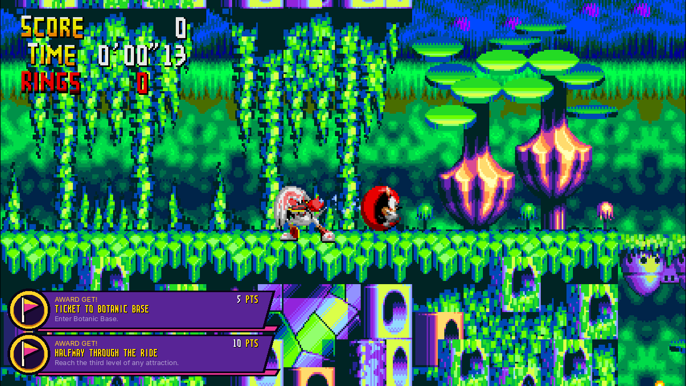
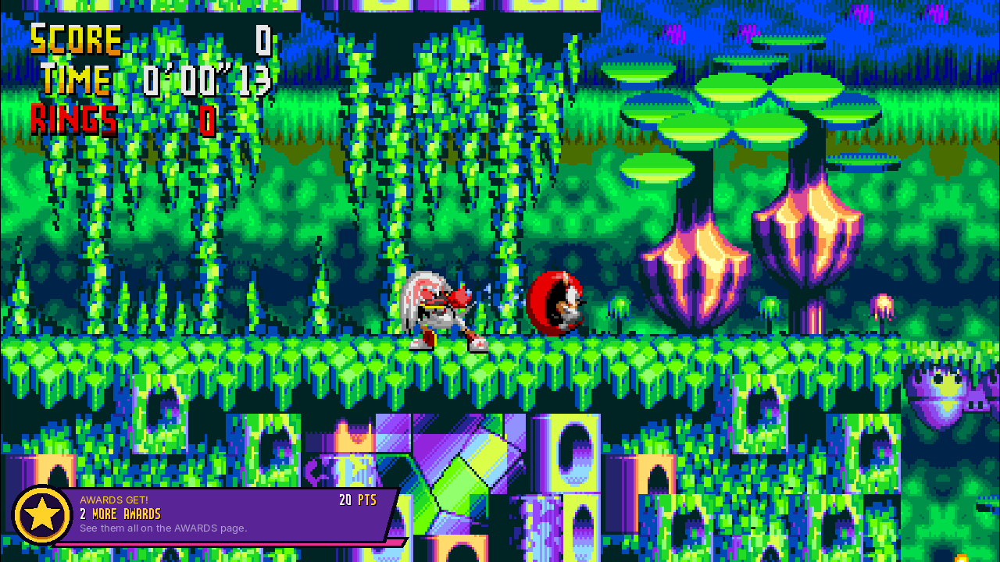
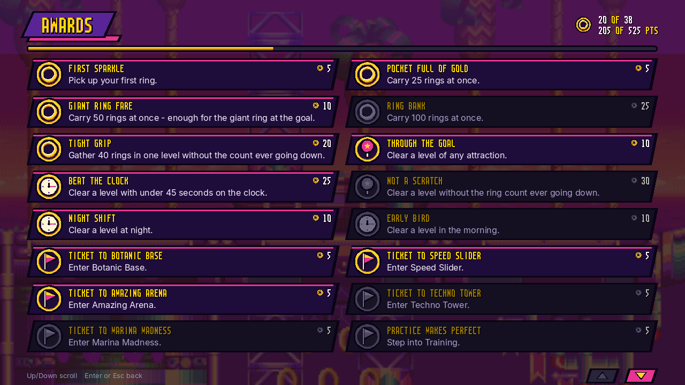
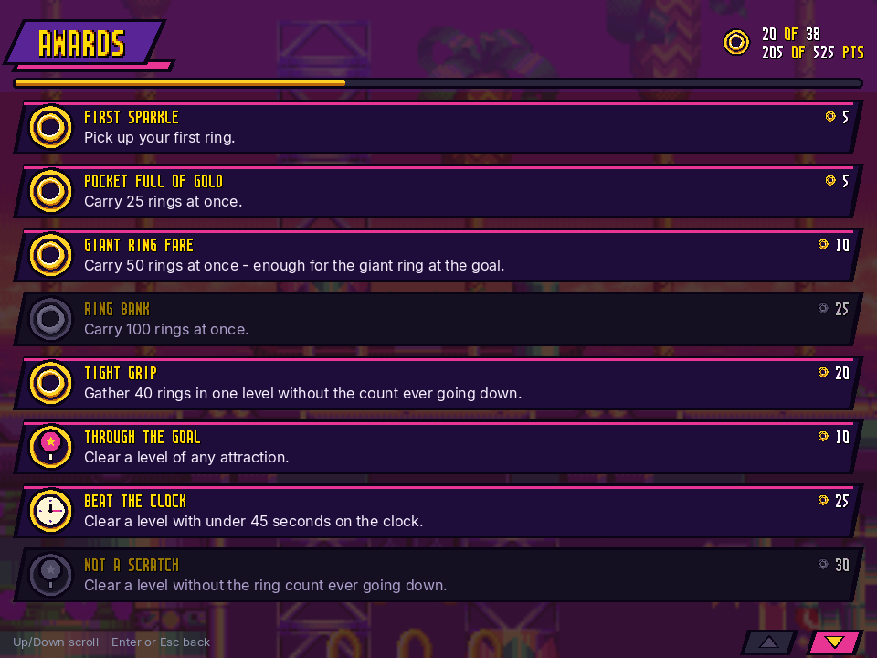

# Achievements

The project ships a small achievement system in the spirit of
[RetroAchievements](https://retroachievements.org/): conditions are written
against the game's own memory and checked once per emulated frame. Everything
is local — the definitions are this project's own, nothing is downloaded, and
no account or network connection is involved.

- Definitions: [`assets/achievements.ini`](../assets/achievements.ini)
- Engine: [`src/game/achievements.{h,cpp}`](../src/game/achievements.h)
- Unlocks: `SaveData/achievements.ini` in the user data directory
- In game: a notification appears on unlock; `F7` lists everything.
  On a gamepad the list is the left stick click (every other button is
  part of the emulated 6-button pad); on a touch screen, the unlock
  counter in the top corner, where the two arrows at the bottom right
  scroll the list. `B`, `F7` or a tap anywhere else closes it again.
- Shipped definitions are compiled into the binary; a copy in the user data
  directory or next to the executable overrides them.
- Off switch: `[Achievements] Enabled = false` in `Config/chaotix.ini`
- Headless: `chaotix_headless --rom <rom> --frames N --achievements assets/achievements.ini`

## Definition format

```ini
[vars]
rings = word FFE008          ; byte | word | long, 68K work RAM address

[achievement First Ring]
id = first_ring              ; stable key stored in the save file
description = Collect a ring.
points = 5
when = mode == 0x38 and rings >= 1
```

`when` is a list of comparisons joined by `and`; every one must hold in the
same frame. Each side is a variable, a number (decimal or `0x` hex), or
`prev(variable)` — the value that variable had on the previous frame, which is
how "it just went up" conditions are written:

```ini
when = rings > prev(rings)
```

An achievement unlocks once and is then written to the save file immediately.

### Attempts: `start` and `fail`

Some awards are about a whole stretch of play ("clear a level without losing
a ring"), which one frame's comparison cannot say. Two more condition lists,
added for issue #3, describe an attempt:

```ini
[achievement NOT A SCRATCH]
id = clear_no_loss
start = clock == 0                                ; a level begins
fail  = rings < prev(rings)                       ; a ring lost spoils it
when  = goal == 0xFF and prev(goal) != 0xFF       ; counts at the goal
```

Each frame `fail` is looked at first, then `start`, then `when`, and `when`
only counts while an attempt is going. A frame that both spoils and begins one
(a new level: the count drops back to zero as the clock reads zero) begins it.
Nothing is going until `start` has held once, and `fail` without `start` is
refused when the file is read. Whenever the tracker loses sight of the game
-- a save state loaded, a rewind, a session of netplay, or frames it does not
look at because a cheat is on or the ring tether is changed -- any attempt
going is dropped and has to start again.

### Icons

`icon` names the emblem drawn for an award in the notification and on the
AWARDS page: `ring`, `chaos` (a Chaos Ring, its colour taken from the title),
`goal`, `clock`, `place`, `team`, `boss`; anything else is a star. Titles are
written in capitals with letters, digits, spaces and `! ? - , . '` only, so
that the game's own letters (MENU_ART.md) can draw them; a unit test checks.

## Game variables

Found by watching 68K work RAM while the game runs and cross-checking against
what the HUD shows (`tools`-free: the scan programs live in the session logs,
the method is described below).

| Address | Width | Meaning |
|---|---|---|
| `FFDFDE` | word | game mode, see below |
| `FFDFF2` | word | attraction id: 0 Botanic Base, 1 Speed Slider*, 2 Amazing Arena, 3 Techno Tower, 4 Marina Madness, 6 Isolated Island, 7 = not in a level |
| `FFDFF4` | word | level number shown on the title card (1-5) |
| `FFE008` | word | ring count; reset to 0 when a level starts |
| `FFE010` | word | the level clock in 1/64 s, high four bits minutes (SPEEDRUN.md); 0 until the player has control and in the lobby, stopped at the goal |
| `FFFDC5` | byte | `FF` from the frame the goal is passed (`$890882`) to the next scene |
| `FFDFF6` | word | time of day: 0-1 morning, 2-3 day, 4-5 sunset, 6-7 night |
| `FFE01A` | word | special stages won (`$927A16` adds one on a clear): 1-6 Chaos Rings, 7-11 clears after all six |
| `FFDFFE`-`FFE002` | byte each | each attraction's progress (the level it is up to); 6 once its fifth level is cleared (`$890F86`) |
| `FFFDD0` | word | the Combi Catcher's controller object while the claw runs, `FFFF` without |

### What issue #3 added, and how each was seen

All by running the game headless and printing the bytes as they change
(`--peek-every`), with the ROM's code read only to find where to look:

- **The goal and the clock.** `tests/recordings/finished_run.txt` clears
  BOTANIC BASE 1: `FFFDC5` goes from `00` to `FF` at frame 3423, the frame the
  run's clock stops, and back to `00` 23 frames into the lobby. `FFE010` reads
  `0` until frame 1341, climbs about 64 a second, and stops at `08A8` -- 34.6 s,
  the results screen's 0'34"66.
- **Chaos Rings.** The goal object, when it comes on screen, puts a giant ring
  `0x60` px above the goal if the player holds 50 rings (`$890666`). With 50
  rings given to the run before that, and the ring moved down into its path,
  the run goes into a special stage without leaving the level's mode `0x18`;
  with its result set to cleared (as the results-screen tests do), `FFE01A`
  goes `0` -> `1` at frame 5194 as the game returns to the lobby. Starting
  from 2 or 5, the same clear makes 3 or 6.
- **An attraction cleared.** The level end writes `level + 1` to the
  attraction's byte at `FFDFFE + place`. The recorded run, its level made the
  fifth after the goal, writes `06` to `FFDFFE` at frame 4639.
- **The bonus stage** is entered from a giant ring with 20 rings or more
  (ISSUE_38_BONUS_STAGE.md). It sets the place and level to WORLD ENTRANCE 3
  for about 20 frames while it loads, then puts the level's back; that is
  what is watched for, from an attraction (`prev(zone) <= 4`), since the
  ending's first scene has the same number but follows the final battle.
- **The final battle** is WORLD ENTRANCE level 2 (ISSUE_56_FINAL_BOSS.md).
- **The Combi Catcher.** `FFFDD0` is `FFFF` in the lobby and holds the
  claw's controller (`AD08`) from Down on the catcher's box until the claw
  gives up its capsule (LOBBY_SHORTCUTS.md).
- **Time of day** needs no new address: a level asked for at NIGHT reads 6,
  MORNING 0, and the end of each level adds one.

\* ids 0, 2, 3, 4 and 6 were confirmed by reading the title card of each
attract demo while logging the variable; 1 is inferred from the remaining
attraction and is the one to re-check first if a "Welcome to..." achievement
never unlocks.

### How these were found

1. Log a value the HUD shows (rings) at two frames of the attract demo, then
   search work RAM for words holding exactly those values at those frames.
   Three candidates survived; only `FFE008` also reset at every level start.
2. For the mode and attraction id, snapshot RAM in several scenes (title,
   five different attract demos) and keep the addresses that are constant
   within a scene and differ between scenes.
3. Confirm by replaying the whole attract loop and printing every change: the
   transitions line up exactly with the level start and end frames.

### The level timer, and getting it wrong

`FFE052` (word) was taken for the level clock, and it is not. It does start
at zero when play begins and it did match the HUD wherever it was checked —
but every check was made in a run where nothing was pressed after the level
loaded. Press anything and it goes back to zero while the HUD carries on: one
jump sent it from 888 to 1 with the HUD going `0'14"58` → `0'16"41`. It is
frames since the player last did something, which is presumably how the game
decides to give up and start its attract demo.

What the HUD draws is the level engine's own frame counter, the long at
`FFE002`, less whatever it held when the clock started. `FFE052` is still what
marks that moment — it reads zero throughout a level's entry sequence, and the
player cannot press anything to reset it before they have control — so the
base is taken on the first frame it is non-zero and it is not used again.
Checked against the HUD at five points in a run with a jump every two seconds:
`0'18"10`, `0'26"43`, `0'31"43`, `0'41"43`, `0'51"43`, all exact, with the
drawn time five frames behind the counter.

That was still not the whole of it. `FFE002` keeps going while the game's own
clock is stopped: pause a level and the HUD holds still while `FFE002` does
not, so a recorded time included the pause — and, as a player reported, the
twenty-five second tally at the end of a level, which is the same thing.

The frames the game was stopped for are counted in `FFAEEC`. It does not move
while a level is being played and advances by exactly the length of a pause
across one; checked by pausing for 600 frames and watching it advance 600. So
a run's clock steps by the counter's change less that one, frame by frame as
differences, because `FFAEEC` starts near 65535 and wraps within a few seconds
of stopped time.

The lesson is the one the attract-demo mistake taught as well, twice over: a
variable that matches in every run you tried can still be the wrong variable,
if every run you tried was the same kind of run. `src/frontend/time_attack.cpp`
is where this now lives, and the frontend's TIME ATTACK records the result.

## Game modes, and why nothing is earned by the demo

`FFDFDE` takes more values than it first appeared to, and getting this wrong
meant every achievement fired during the attract demo and none of them while
anyone was playing:

| Mode | What is on screen |
|---|---|
| `0x00` | boot |
| `0x08` | the title screen and the game's own menus |
| `0x38` | **the attract demo** - the game playing itself |
| `0x48`, `0x60`, `0x68` | the selection screens behind Scenario Quest and Training |
| `0x18`, `0x58` | a level, with the player in control |

Each value was checked against a screenshot taken at that moment rather than
guessed. The `[rules] require` line excludes the modes that are not play,
which is safer than listing the ones that are: an unlisted play mode would
silently earn nothing, while an unlisted non-play mode at worst lets a
level's own title card count as starting that level.

```ini
[rules]
require = mode != 0x00 and mode != 0x08 and mode != 0x38 and ...
```

`require` is checked before any achievement, so an individual `when` only has
to say what the achievement itself is about.

## Adding achievements

Add a `[achievement ...]` block to `assets/achievements.ini`, give it a unique
`id`, and check it with the headless runner:

```bash
build/chaotix_headless --rom <rom> --frames 12000 --achievements assets/achievements.ini
```

It prints the frame at which each achievement unlocks, so a definition that
fires too early (or never) is obvious. `tests/test_achievements.cpp` covers
the parser, the trigger evaluation and attempts with a fake memory image, and
checks the shipped file (unique ids, the ids save files already hold, titles
the game's letters can draw). In `tests/CMakeLists.txt`, the
`achievements_*` tests earn the awards in the game itself: the attract demo
earns nothing, the recorded run earns the goal awards (and loses NOT A SCRATCH
when its rings are taken away), and the Chaos Ring, attraction, bonus stage,
final battle and Combi Catcher tests each reach their scene. Where the
recording does not go far enough a `--poke` gives the game the state it would
have reached, and the comment says which; the other four attractions' awards
are checked only against fake memory, by the same rule as Botanic Base's.

## How they look

Issue #3 asked for awards that look like part of the game. The notification
is a slanted purple banner edged in black with a magenta strip, sliding in
from the left: the award's emblem in a gold medallion over its end (a ring
award's ring turns, the way the game's rings do), the title in the game's own
letters, the description and the points. The AWARDS page (`F7`) is the same
idea: a title banner, a ring-gold meter of the points, and a card for each
award, greyed until it is earned. Two columns on a wide window, one on 4:3 or
a phone, where the cards are taller (MENU SIZE).

Earning several at once (a level that starts on the fifth level of a new
attraction, a save loaded with Chaos Rings in it) no longer stacks a banner
for each up the side of the screen (`src/platform/toast_queue.h`). At most
two award banners show at a time; the next waits for a place, and while any
wait, the ones up stay 2.5 seconds instead of 5. When two or more are still
waiting beyond the free places they fold into one banner, "N MORE AWARDS",
with their points added up and a star; the AWARDS page lists them. Other
notifications (TIME ATTACK, NETPLAY, save states) answer something the
player just did, so they never wait.







Everything is drawn from shapes (`src/platform/award_art.*`); no picture of
the game's is used, and the letters are the menu's (made from the player's ROM
when the program runs, MENU_ART.md), falling back to the pixel face.
