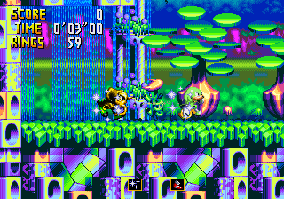
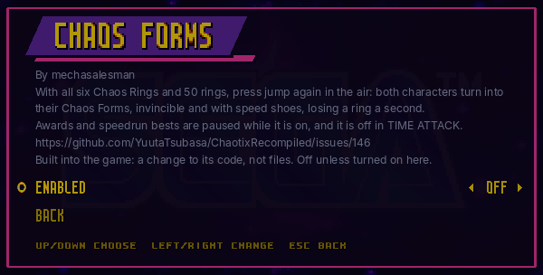

# Chaos Forms

The classic "super form", powered by the game's Chaos Rings. A built-in mod
by [mechasalesman](https://github.com/mechasalesman), proposed with a
working patch in [issue #146](https://github.com/YuutaTsubasa/ChaotixRecompiled/issues/146)
(Archie's "Chaos Knuckles" is the model). Off until turned on in
OPTIONS > EXTRAS > MODS, under BUILT-IN MODS (see MOD_PACKS.md).

## How to transform

1. Hold all six Chaos Rings (win the six special stages, or use the
   ALL CHAOS RINGS cheat in OPTIONS > EXTRAS > CHEATS).
2. Have **50 rings or more** in a level.
3. Jump, then press jump again in the air (the second press of a double jump).
   Not during the fall and spin that starts a level: the form waits until you
   have control (the level clock, `FFE010`, is running).

Both characters, the one you play and the partner, transform at the same time,
with a sound, so you can tell the form has begun: the game's own giant ring
sound (sound effect `$46`, the one heard on entering a special stage), played
rising instead of falling, so that it sounds like a beginning rather than an
ending. The giant ring itself still sounds as it always has.
The press is taken by the transformation, so Knuckles does not glide, Charmy
does not fly and so on on that jump; keep holding the button and the game
still does not see it until you let go.

## What a Chaos Form does

* It gives invincibility and speed shoes together, as the two monitors do, but
  with no music (nothing is requested from the sound driver).
* It costs one ring for every second of the game running (not while paused).
  At 0 rings or fewer the form ends, as the monitors' effects wear off.
* Turning the mod off (or starting a TIME ATTACK run) ends a form at once.
* The music: a form asks for none, and ending it changes none. If a monitor's
  invincibility or speed shoes (and their music) were running when the form
  began, the form ends through the game's own end of those timers, so the
  level's music comes back as after a monitor.
* An invincibility or speed shoes monitor broken during a form (issue #146,
  reported by mechasalesman) changes no music either: no invincibility tune,
  no faster music; the level's music plays on. The monitor still breaks,
  with its sound, and its time is added to the form's, which already gives
  both effects; it is taken into the form and ends with it (it does not run
  on after the form, which would bring the monitor's music in late). Other
  monitors are as they were.
* A new level never starts in a form. A form also ends the moment the level
  does: when the end-of-act sign is touched or a boss is beaten.
* It works in the attractions and in the final battle (WORLD ENTRANCE level 2),
  not in the lobby, the bonus stage or the ending's scenes.
* The palette changes, pulsing once a second between a brighter and a mid tone:

| character | change |
| --- | --- |
| Knuckles | red body -> lime green (the Archie "Chaos Knuckles") |
| Vector | greens -> gold |
| Charmy | yellow/orange stripes (and his cheek and ring) -> gold |
| Espio | body pulses through the rainbow colours the game itself cycles him through |
| Mighty | red back -> green |
| Bomb | red body -> lime green |
| Heavy | silver body -> gold |

## Settings

OPTIONS > EXTRAS > MODS > CHAOS FORMS (`[Mods] BuiltIn = chaos_forms`), off
by default. Once on, it does nothing until you hold all six Chaos Rings.

* It is off during TIME ATTACK, so records compare like with like.
* While it is on, awards are not earned and a speedrun is not kept as a best,
  as with cheats and a changed ring tether.
* In netplay the host's setting is used by both players.
* `chaotix_headless --chaos` turns it on for tests.

## How it works (for maintainers)

`runtime/chaos_forms.cpp`, called from `Machine::run_frame` before the frame
runs. A character's status object (the word at +$3A of its object, whose
address is at $FFE034 / $FFE036) holds the invincibility timer at +$32 and the
speed shoes timer at +$34 (the game's own code, $88E85A). A form holds both
from $7FFF and lets the game count them down (the stars circle by that timer; a whole turn is added before they near the mark), which is also how it is recognised: no host flag says one is on.
The monitors (issue #146) are the game's code with three hooks
(`runtime/patches.h`), each doing nothing unless `quiet_monitors` (the mod
on, in a level, a form on): the invincibility monitor (`$8901E0`) asks for
its music `$12` with `$8F6E76`; at the request (`kSoundRequest`, the return
address `$8901E8` on the stack) the id becomes `$7F`, no sound's, which the
routine puts in a free one of the driver's three slots as a sound effect,
and `kSoundDone` (`$8F6EB6`, the Z80's bus still held) takes it out again,
so the Z80 never sees a request, nor the reset of its music speed a music
request makes. The speed shoes monitor (`$8901A6`) writes `$B0` to Z80 `$3F`
(faster music) with the bus held: `kShoesTempo` keeps the byte in `d0`, which
that routine does not use and its caller restores, and `kShoesTempoDone`
puts it back. Nothing is kept on the host between the hooks, so a save state
taken between them (a frame ends anywhere) loads the same.
The transformation's sound is put in the driver's slots from the host, between
frames, as `$8F6E76` puts a sound effect (`patches::request_sound`): the
first free slot, or none when all three are taken. It is
`chaos_forms::kTransformSound` (`$46`). `$46`'s FM6 track (`$E6F5` in the
driver's bank `$8D0000`, ROM `$50000`; FM5 plays the same two frames later
through an `F6` jump into it) repeats four notes going down, each repeat an
octave lower (`FB F4`) and quieter (`E6 06`). The form's version (the
owner's pick of three on #146) has the notes going up (`CF D2 D5 D8`), a
semitone higher each repeat (`FB 01`) and a gentler fade (`E6 02`). It is a
copy of that track, made from the ROM's own bytes with those edits when it
is first needed, in the unused end of the same bank (`$C200`, all `FF`),
followed by a word that keeps the ROM's checksum as it was (the game checks
it when it starts). Nothing else changes: the giant ring sound reads the
original, the ROM is not counted as patched (`Rom::patched`, its SHA-1, the
awards and save states are as before), and nothing is written while the mod
is off. At the end of the frame of the request the driver has set up the
sound's tracks without playing them; in the four frames after the
transformation (counted in the top bits of `Machine::chaos_jump_prev`, in save
states; not from the form's timer, which a monitor raises and a long form
passes through again: Codex review), a sound effect track at the very start
of `$46`'s FM6 track, or waiting on FM5's `F6` jump into it, is pointed at the
same place in the copy (a giant ring sound already further on is left alone;
none of this happens if the driver's slots were full and no sound was
queued) (Z80 RAM `$1EB0`, three tracks of `$30` bytes, the pointer at +3).
A save state taken while it plays, loaded in a session where the copy was
never made, makes it again. If the ROM is not laid out as expected, the
sound plays as the giant ring's.
`chaotix_headless --chaos-sound ID` plays another sound instead (as it is),
for trying them, and `--sound-log` prints every sound the driver is asked
for.
The palette is output only (`Machine::chaos_pal`, used by `render_line32x`
after the character mods), so CRAM, fades and both CPUs never see it.
`Machine::chaos_drain` (frames towards the next ring, and the "jump button
taken" top bit), `chaos_last_tick`, `chaos_jump_prev` and `chaos_forms` are
in save states (format 3).
