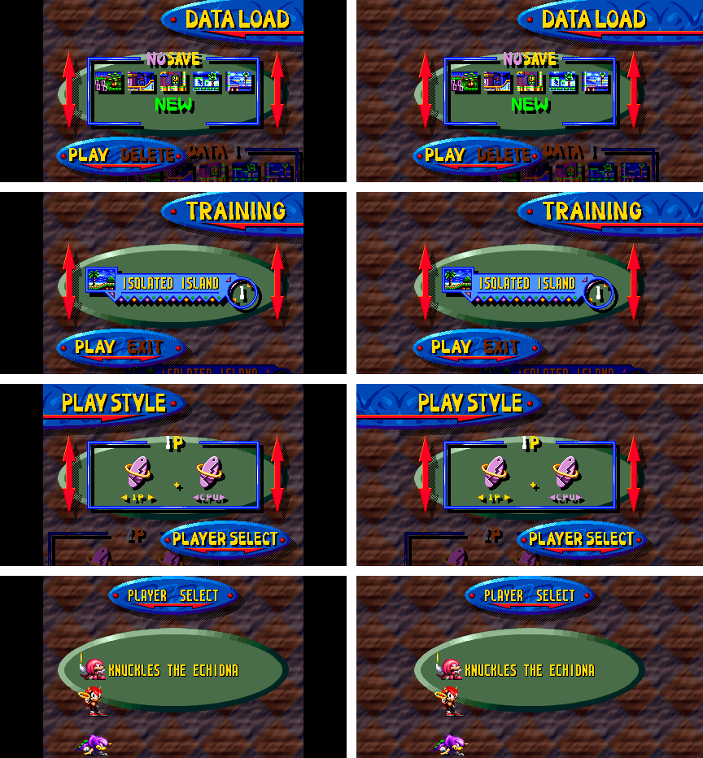

# Issue #135: DATA LOAD, TRAINING, PLAY STYLE and PLAYER SELECT in widescreen

Asked for in [#135](https://github.com/YuutaTsubasa/ChaotixRecompiled/issues/135):
at 16:9 these screens stayed 4:3 with black side bars, and the request was to
carry their rock backdrop on into the sides.

## What the screens are made of

Rendered one layer at a time (`chaotix_headless --layer md` / `--layer 32x`),
reached from power-on with Start at 1750, Down at 1850 (TRAINING) and Start at
1950, 2250 and 2550; DATA LOAD with Start at 1750 and 1950:

| screen | game mode (`$FFDFDE`) |
| --- | --- |
| DATA LOAD (and its SAVEMODE box) | $60 |
| TRAINING, PLAY STYLE | $68 |
| PLAYER SELECT | $48 |

- **The rock** is the 32X picture, which the game draws only 320 px wide (as
  on the title, [issue #77](ISSUE_77_WIDE_TITLE.md)). It is a tile 64 px
  wide, repeated: on every line, each pixel of TRAINING and PLAY STYLE is the
  same as the one 64 px to its right (100%), and PLAYER SELECT's is in 93%
  of places, the rest being the characters, which are 32X sprites. It does
  not move: frames 1 and 20 apart are identical.
- **The banners, ovals, arrows and panels** are the Mega Drive's planes and
  sprites. The planes are 512 px wide, so a banner running off one side of
  the screen comes round on the other: with the bars simply taken off,
  DATA LOAD's banner showed a piece of its end at the far left.

## The change

When widescreen is on and the game is in one of those modes,
`Machine::render_output_line` no longer paints the margins black:

- **The rock goes on into the margins** (`render_line32x`, `repeat`). Each
  margin pixel takes its place in the 64 px tile from most of the screen's
  five tiles, so a character standing on one tile (PLAYER SELECT) is not
  carried into the margin; with no majority, the nearest tile's pixel is
  used.
- **The planes show in the margins only where they carry on from the edge**:
  on each line, from the screen's edge outward, for as long as the plane is
  not the backdrop. A banner going on past the edge (DATA LOAD's to the
  right, PLAY STYLE's to the left) goes on; a piece that comes round from
  the other side, cut off from the edge, is the backdrop instead, so the rock
  shows there.
- **Only while the picture is that backdrop** (`patches::menu_backdrop_tiled`,
  once a frame): the mode changes while the title is still up and fading, and
  its girders are not a tile. On a sample of lines at least three quarters of
  the 32X pixels must match the one 64 px further right; otherwise the bars
  stay, as before.

What the game draws beside the screen still shows: the next save slot's
panel at DATA LOAD's lower right, and the next zone and PLAY STYLE's 2P
panel below, were already partly on screen in 4:3, and the margins show
more of them. Nothing is patched in the game, so it runs as before, and
lockstep, netplay and the attract demo are unaffected.

## Pictures

4:3 (left) and 16:9 (right): DATA LOAD, TRAINING, PLAY STYLE, PLAYER SELECT.

## Validation

- `widescreen_render.the_menus_carry_their_tiled_backdrop_into_the_margins`
  (new): only modes $48, $60 and $68; the margins repeat the tile, a
  "character" on one tile stays out of them, without `repeat` the margins
  stay transparent, and a picture that is not tiled is not taken for the
  backdrop.
- Headless runs at `--wide 53` and `--wide 80` (the widest) of the four
  screens and of the frames between them: the title fading into TRAINING
  keeps its bars, banners sliding from TRAINING to PLAY STYLE stay joined to
  the edge, and the SAVEMODE box slides in through the margin.
- The program at 1280x720: the screens fill the window.
