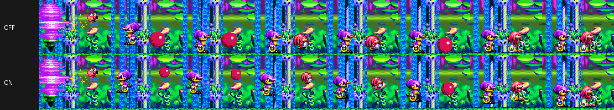

# The glide into a level's start (issue #136)

As a level begins, the two characters circle a purple whirlwind. On one frame
the whirlwind is gone and the game puts both at their start point. The 32X
original does the same, and it does it at every aspect ratio, not only in
widescreen. With OPTIONS > VIDEO > SMOOTH START on (the default), the picture
shows them sliding there over 16 pictures instead, about a quarter of a
second.

## What the game does

Measured in Botanic Base 1 with Knuckles and Espio (`chaotix_headless --stage
300:0:1:0:2:7:0 --sprites-log ...`):

- **While circling,** the characters are drawn by the scaled blitter, their
  depth shown as their scale. A scale is a step in 8.8, so a larger number
  draws smaller. On the last picture Knuckles is at (198, 72) with scale
  0x176, about two thirds of his size, and Espio is at (122, 88) with scale
  0x8A, nearly twice his size.
- **On the next picture** both are drawn unscaled on the ground: Knuckles at
  (184, 112), Espio at (136, 101). That is 40 pixels down for Knuckles.
  - In the game's objects (`FFAD48`, `FFAE08`, +8 X and +C Y) the positions
    are set in one frame.
  - The interpreter and the recompiled code agree, so this is the game's own
    code, not the port.
- **Other levels** are the same, with other places. In Marina Madness 1 the
  characters jump from the screen's edges to its middle, 118 pixels. Some
  levels (the fourth of the first zones) start the characters where they
  land, and nothing jumps.

## How the glide is drawn

The 32X sprite recorder (`runtime/sprite_record.*`, docs/SPRITES_32X.md)
already lists every draw of a picture. The sprite replacement composes a
picture again from that list (`SpriteLayer::compose`). The glide uses the
same path, with the characters' draws put elsewhere
(`runtime/start_glide.*`):

1. **Finding the characters.** They are the draws with a colour offset:
   0x12 for the player's, 0x24 for the partner's. A character's place is its
   first draw's hotspot and scale. Its other draws (Espio is two graphics at
   one hotspot, a second set) move and scale with it.
2. **Finding a jump.** A jump is a picture where a character drawn scaled in
   the picture before is now drawn unscaled. Its scale must have changed by
   at least 0x10, and its place by at least 6 pixels.
   - In play the partner is scaled too, as it comes back from the
     background, but its scale steps by 2 to 4 a frame to 0x100.
   - Random play through all five zones, levels 1 to 5, at 4:3 and
     widescreen: every level start found once per character, and nothing in
     play.
3. **Drawing the glide.** For the next 16 pictures each character is drawn
   at a mix of where it was and where the game has it. The mix eases in and
   out (smoothstep).
   - The scale is mixed too: Knuckles grows from his far size as he lands.
   - A character drawn larger than life was nearer than the whirlwind, and
     hidden in it. Espio, in Botanic Base, starts at his own size rather
     than as a giant popping out of the whirlwind.
4. **Composing.** Each moved draw is composed like a replaced one.
   - Its original pixels are taken away, and what lay under them shows.
   - It is drawn again at the new hotspot and scale by the host-side
     blitters, in its place in the list.

The recorder follows frame buffer writes, which composing needs, only while
a glide can come. That is from a picture with a character drawn scaled to
the end of a glide. The rest of the time the option costs only the
recording, about 2% of a frame.

## What it does not change

The machine never sees the glide. Its frame buffers, registers, the
characters' positions and the timing are the original ones:

- With and without SMOOTH START, `--state-hash-every 1` gives the same hash
  on every frame except the 15 pictures of the glide. That hash includes the
  output picture, and it agrees again from the first frame after the glide.
  A difference in the machine would have carried on.
- `--lockstep` stays bit-identical with the glide on.

Replays, ghosts, netplay and speedrun timing are therefore unaffected. A
netplay peer with the option off sees the original jump.

`chaotix_headless --start-glide` turns it on for tests. The run ends with
`start glide: N glide(s), M pictures composed`.
