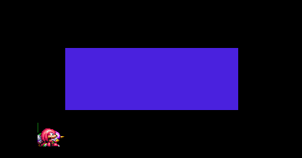
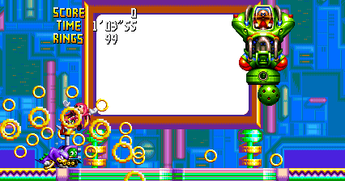

# Issue #147: AMAZING ARENA's boss froze in widescreen

Fixed in 0.15.23.

## What was wrong

In widescreen, AMAZING ARENA's boss (level 5) froze after its entrance: the
screen went black with a coloured box, nobody could move, and only the
pause menu still worked. In 4:3 the fight played.

The boss enters with a letterbox: the game moves the top and bottom of the
32X clip rectangle (SDRAM `$06003834`, see `patches.h`) in, from 0 and 223 to
`$48` and `$97`, and back out again, a line a frame. The widescreen patch
wrote its own rectangle over it every frame (`patches::begin_frame`): the
sides widened, but also the bottom back at 223 (plus the extra rows). The
letterbox was gone, and the 32X drew what it hides.

One sprite it hides (bank `$49`, frame 7, at 32, 176) is never drawn in the
original game. Its spans have end bytes past 127, which the clipping blitter
(`$06001380`) reads as negative (`mov.b` sign-extends): the span is taken
for one to skip, the skip is negative, and the blitter walks back into the
picture's own bytes. It came to a copy of 2,147,483,597 words
(`$06001478`) and the master SH-2 never finished the frame.

The rest followed from that. The 68K sends the 32X its palette writes
(the list at `$FFD860`) only once the SH-2 has finished a frame (`$A15120`
clear, `$8831AE`). The list grew by `$14` bytes a frame. The characters' own
palette writer (`$88E790`) does not check the list's size, as the others do
(`$883142`, `$8B4B36`), and after 52 frames it wrote over the Mega Drive
DMA queue behind it (`$FFDC74`). Its count became `$2008`, and the 68K hung
working through that queue.

## The fix

`begin_frame` widens only the screen's own bounds. The sides are widened
when they are the screen's (0 and 320) or ones the patch wrote; the bottom
gets the extra rows when it is the screen's (223) or one the patch wrote.
Bounds the game set itself are left as they are. The letterbox now closes
and opens as in 4:3, with the sides widened, and the boss fights.

## Reproducing it

The level must be played with its lights on (`$FFC21D` bit 5: AMAZING
ARENA's light switch; without it the goal says NO CLEAR and the level
starts over). The boss waits at the goal. The test puts both characters
there:

    chaotix_headless --rom <rom> --frames 3200 --wide 53 \
        --level-select --stage 300:2:5:0:2:7:0 --poke 1500:C21D:20 \
        --poke 1500:AD50:0E --poke 1500:AD51:80 --poke 1500:AD54:01 --poke 1500:AD55:00 \
        --poke 1500:AE10:0E --poke 1500:AE11:60 --poke 1500:AE14:01 --poke 1500:AE15:00 \
        --peek-every 3200:8064:2

The boss (`$FF8040`) keeps its step at `$24`. Before: `0202` from frame 2395
on, and the master SH-2 at `$06001478` for good. After: `0210` at frame 3200,
as in 4:3. Tests: `widescreen_amazing_arena_boss_fights` (the ROM run above)
and `widescreen_render.a_letterbox_the_game_sets_keeps_its_bounds`.
