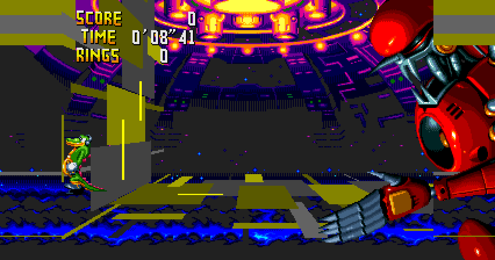
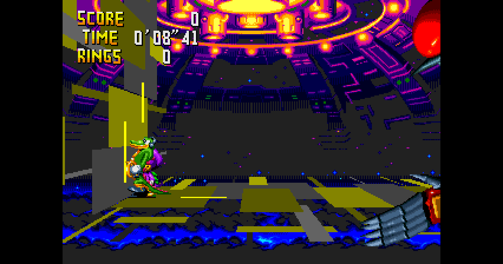

# Issue #56: the final boss widened by WIDE LOBBY

Fixed in 0.15.4 (#58).

## What was wrong

With OPTIONS > VIDEO > WIDE LOBBY on (`WidescreenEverywhere`,
`Machine::wide_everywhere`), the final boss fight was widened: the margins
showed stretched yellow and grey bars, and the boss was cut off at the 4:3
edge. With WIDE LOBBY off the fight was already 4:3 and correct.

The fight is WORLD ENTRANCE (zone 7) level 2; levels 2-6 of that zone are the
final boss and the ending's scenes (LEVEL_SELECT.md). `patches::wide_zone`
let WIDE LOBBY widen the whole zone, but the arena's floor and pillars are
drawn by the 32X across the 4:3 view only, so the margins showed what was
left beside it.

## The fix

`wide_zone` lets WIDE LOBBY widen only the lobby itself (levels 0 and 1,
`kLastLobbyLevel`); the rest of the zone stays 4:3 with black side bars,
exactly as with WIDE LOBBY off.

## Reproducing it

    chaotix_headless --rom <rom> --level-select --stage 300:7:2:0:4:7:0 \
        --wide 53 --wide-everywhere --trace-wide --frames 2400 --shot 2000

Before: `widescreen: margins live from frame 482`. After: `margins live for
0 frames`. Test: `widescreen_final_boss_stays_4_3_with_wide_lobby`.
