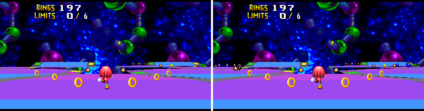
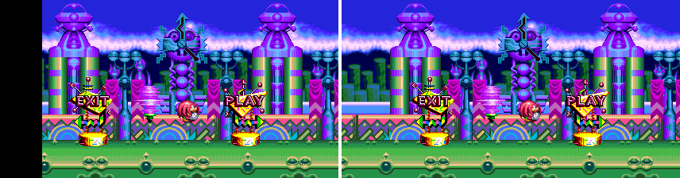
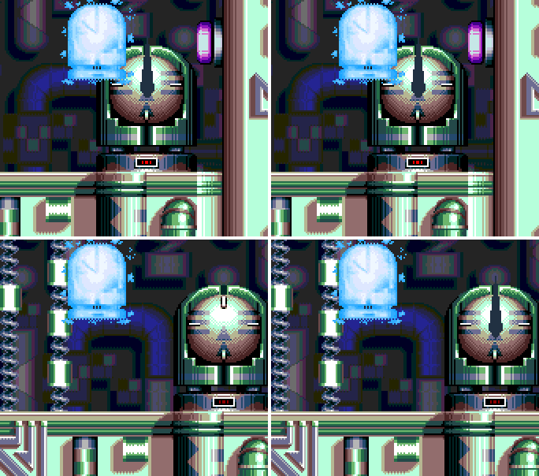
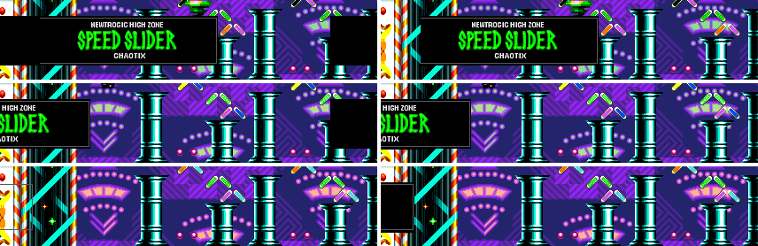
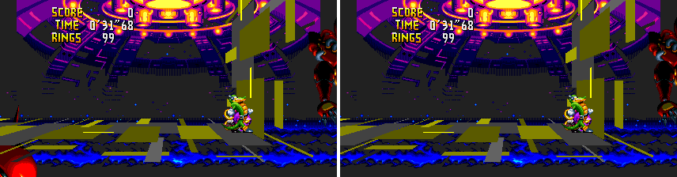

# Issue #5: four widescreen fixes (special stage, arena clock, title cards, final boss)

A list of widescreen problems was reported on issue #5 (2026-11-24). All of
them were reproduced on 0.15.24 with `chaotix_headless --wide 53` (16:9).
This change fixes four that are plain bugs in a widened scene. The others
wait for a decision or more information and are not touched here: the black
space at the lobby's outdoor entrance (2), the Combi Catcher's sky (3, not
reproduced), the Combi Catcher and roulette room in 4:3 (4, on purpose since
issue #61), the launcher (7, not reproduced) and the white ending in 4:3 (9,
on purpose since issue #61).

In every case the game runs exactly as before: the 4:3 picture, the 68K work
RAM and the timing are unchanged, and the interpreter and the recompiled code
agree frame for frame. Only what the margins show changes.

Screenshots: left or top 0.15.24, right or bottom this change.

## 1. Special stage: rings, spheres and stars stop at the 4:3 picture

**Cause.** The stage's tube is widened (issue #18), but its objects are
sprites: projected by the add at `$06004BE0`, then blitted scaled
(`$06001F18`). The blitters clip them to the rectangle at SDRAM `$06003834`,
which the stage sets to its own 288 px picture, [16, 304). Anything outside
it was never drawn, so the rows of rings ended at the 4:3 edges while the
tube went on.

**Fix.** While the stage is widened that clip is [-C, 320 + C), as in the
bonus stage (C: the margin rounded up to 8), and it is put back to [16, 304)
when the stage ends. Sprites are drawn where the game puts them; what lands
outside the native columns goes to the margin shadow as before
(`patches::begin_frame`, `kSpecialSpriteClip`).

**Verification.** `widescreen_special_stage_objects_in_the_margins` (frame
1200 of the reproduction, rings and spheres in both margins; 0.15.24's hash
differs). `special_stage_objects_centre_and_ram_match_4_3`: over 2400
frames the stage's picture matches a 4:3 run (polygon edges as before) and
the 68K work RAM is identical on every frame (`--compare-ram`, new).

## 2. The lobby's entrance: a black strip on the left

(Frame 600 of `--stage 300:7:0:0:2:7:0 --press 600:right:2600 --wide 53`.)

**Cause.** In WORLD ENTRANCE the camera is not clamped (issue #61: the
lobby's events follow it, so the run must be the 4:3 one), and at the
outdoor entrance it is at X 0..12. `margin_cut` blacked out the margin
columns left of the layout's origin, since the plane ring holds no layout
there: the part of the left margin left of world X 0 was black.

**What the game has there.** Plane A, the towers, signs and pillars, has no
layout left of X 0 (streamed there, it is whatever the ring last held:
pieces of the lobby further right). Plane B is not the layout: in the lobby
it is one 512 px picture per part, and the outdoor part's picture is the
sky, the trees, the rail and the floor the characters walk on. Its rows are
line-scrolled, the floor's with the camera, so the game itself wraps that
picture round its 512 px as the player walks: the columns left of X 0 are
the same picture, drawn the same way.

**Fix.** Left of the origin the lobby's margin shows plane B and leaves
plane A out (`MarginCut::backdrop`, drawn with `Vdp::plane_a_hide_*` like the
final boss's plane A). Render only: the machine state is identical to
0.15.25's on every frame checked (`--state-hash-every`). A level keeps its
black columns there (its camera clamp keeps them out of view in any case);
the lobby's own black columns (a room, a fade) stay black.

**Verification.** `widescreen_lobby_entrance_left_of_the_origin` (frame
600; 0.15.25's hash differs), the unit test
`widescreen_render.the_lobby_entrance_shows_plane_b_left_of_the_origin`,
and the lobby's existing centre, palette and lockstep tests. The return to
the lobby after a level (`finished_run.txt`, frames 4850-5600, at NIGHT)
shows the same picture in its own colours.

## 5. AMAZING ARENA: the clocks have no hands in the margins

**Cause.** The dial is plane tiles; the hand is a polygon object. The 68K
asks for it with command `0x0C` on its 32X command list (`$881118`, X and Y
from the screen's centre). The master SH-2 projects it with the special
stage's projection code, which the boot code's SDRAM image holds too, and
its rasterizer (`$06004858`) clips each polygon to the rectangle at SDRAM
`$06003844`, the full 4:3 screen in a level. The object itself is kept by
the 68K (its on-screen test is [-64, 384)), so only the clip was in the way.

Widening the game's own drawing, as the special stage's is, would change the
4:3 picture: the rasterizer cuts a polygon at the rectangle with integer
maths, and a polygon cut at another point has its slanted edge a pixel apart
inside the picture too. It showed on the title card's polygons (7 pixels at
frame 543 of AMAZING ARENA).

**Fix.** The game's drawing is left as it is. A hook at the rasterizer's
entry, run before the same instruction by the interpreter and the recompiled
code, reads the polygon (vertex count, vertices, fill word) and the host
draws the part outside the native columns, and on the rows below the screen,
into the margin shadow, in the order the game draws
(`patches::level_polygon_margins`). Nothing the machine reads changes. The
sprite recorder and the replacement layer are told those bytes are not
sprites'.

**Verification.** `widescreen_amazing_arena_clock_hands_in_the_margins`
(frame 1220, the clock wholly in the right margin, now with its hand),
`widescreen_amazing_arena_centre_matches_4_3` (the 4:3 picture identical on
every widened frame) and `lockstep_widescreen_amazing_arena_polygons`. A
level's work RAM is not identical to a 4:3 run's in any case (the plane ring
shift and the ring cull, issue #7), so the RAM check is not used there.

At the widest margin (80 px) an object more than 384 px right of the camera
is still not drawn: that is the 68K's own test, and moving it would change
the game.

## 6. Title cards stop just past the 4:3 edge

**Cause.** A widened level's margins are in the host-side shadow, which the
game never clears. They were cleared, with the fill's colour, whenever an
auto fill started at a line's first column: meant for the game's per-frame
clear (161 words from column 0). The title card's black bar, though, is a
polygon whose rows begin at the screen's left edge, filled from column 0 by
the rasterizer. On its rows it painted the whole of both margins: a black
box stayed in the right margin, the left margin was black whatever the bar's
length, and when the bar's right end passed the 4:3 edge it all went at once,
leaving the card's pieces standing in the margin.

**Fix.** Only a fill that covers the whole native line from its first column
clears the margins (`patches::fill_clears_margins`), in the machine, the
sprite recorder and the replacement layer alike. In every zone, the shorter
fills from column 0 all come from the rasterizer, and the game's clears are
161 or 256 words. The rasterizer clips at x 319, so a polygon's span is at
most 160 words; a 160-word fill is still a clear (a full-screen flash is one)
unless it is on a row of the polygon being drawn, in its fill word. The bar's part in the margin is
then drawn by the host like any level polygon (item 5), so it slides on into
the left margin with its text.

**Verification.** `widescreen_title_card_slides_into_the_margin` (frames 2420
and 2438 of the SPEED SLIDER landing; both hashes differ on 0.15.24). The
lobby walk's centre check (`widescreen_lobby_centre_matches_4_3`, which
lands in SPEED SLIDER and shows its card) still passes.

**Left as it is.** The card's pieces are removed on a timer (each piece's
routine counts down at `$28` of its object, then deletes itself, `$8AC8E4`),
not when they leave the screen. When the bar goes, its right end is about
25 px into a 53 px margin, so the last strip of it still vanishes there at
once. Taking it further would mean moving the pieces faster or keeping them
longer than the game does, which changes the game's objects.

## 8. Final boss: red Metal Sonic on both sides at once

**Cause.** Part of red Metal Sonic is a 128 x 128 px picture in plane A
(16 x 16 cells), which the boss moves by scrolling the plane, and parks at
screen X -128 (horizontal scroll -640), just off the 4:3 screen. A 512 px
ring seen 320 px wide leaves a 64 px gap in which a 128 px picture is hidden
however it is taken; seen 426 px wide there is no such gap. So the parked
picture showed in the left margin while the boss's body came in on the
right.

**Fix.** In the widened final boss, plane A's picture (what the longest run
of empty name table columns leaves) is drawn in the margins only where that
placement of it also reaches into the native columns, i.e. where it carries
on what the 4:3 picture shows. When it flies across the screen it still
continues into the margins. This is render-only
(`patches::boss_plane_a_margins`, `Vdp::plane_a_hide_*`).

**Verification.** `widescreen_final_boss_picture_not_round_the_ring` (frame
3400 of the reproduction) and the unit test
`vdp_widescreen.the_final_boss_picture_shows_in_the_margins_only_beside_the_screen`.
The existing `lockstep_final_boss_widescreen` and `widescreen_final_boss`
pass.

## Also

- `chaotix_headless --compare-ram` (with `--compare-native`): the 68K work
  RAM of the 4:3 and the widescreen machine must be the same after every
  frame.
- `--compare-native`'s 4:3 machine now gets the same `--cheat` writes and
  second pad as the widescreen one; with a cheat the two runs used to differ
  from the first frame.

## Checks

Full `ctest` and the 33-run lockstep sweep (all special stages, levels,
bonus stage, hub, random input) on Windows (MinGW), with the ROM.
