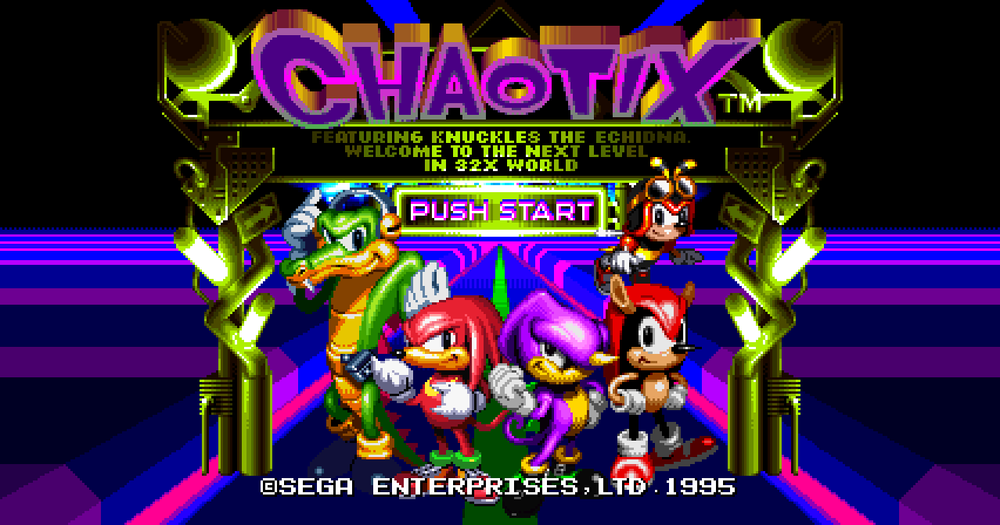
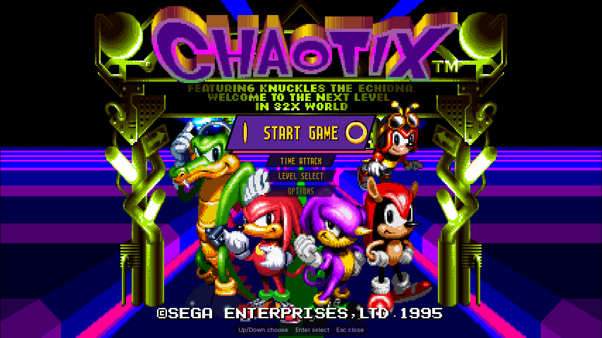
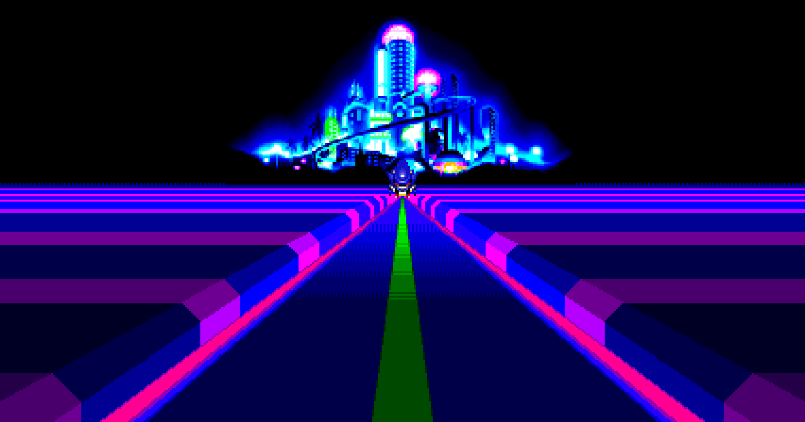
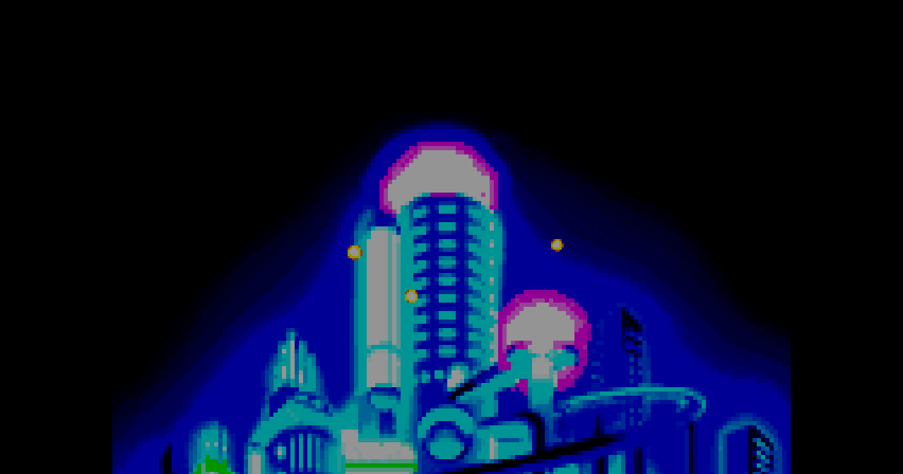

# Issue #77 (and #78): the title screen in widescreen

Reported against 0.15.9: at 16:9 the title screen stayed 4:3 with black side
bars while the rest of the game went wide. The request was to carry the
girders and the horizon on into the sides instead.

## What the title is made of

Rendered one layer at a time (`chaotix_headless --layer md` / `--layer 32x`,
frames 300 to 2100 from power-on):

| what | layer |
| --- | --- |
| the SEGA logo and its starfield (modes $00-$14) | 32X frame buffer only; the Mega Drive layer is black |
| the intro's city, Metal Sonic | 32X |
| the horizon: the road, the green stripe, the bands of floor | Mega Drive planes |
| the logo, the characters, PUSH START, the girders either side, the copyright line | 32X, one picture |

The title runs in game mode $08 (`$FFDFDE`), from the city at about frame
380 to the attract demo at 2024 (or for as long as the front end holds it,
`runtime/title_hold.h`).

### The horizon is already wider than the screen

The game fills all 64 columns of its planes with the floor, not just the 40
the screen shows. With the side bars taken off, the margins show it carrying
on:

- the left margin is the exact mirror of the right one, as the floor is, on
  every title frame of the 36000-frame attract run (sampled every 10 frames:
  629 frames with something in the margins, none asymmetric); anything the
  game had not drawn there would not be;
- on 122 of the 124 floor lines the column beside the 4:3 edge has the edge's
  colour (the other two are where a band's slanted edge crosses it);
- while the planes are empty (the boot screens, the city) the margins are
  black, and when Start is pressed the floor goes from the margins on the same
  line and frame as from the centre.

So nothing has to be drawn or invented: the margins just stop being covered.

### The girders cannot be carried on

The girders are part of the 32X picture, which is drawn for the 320 px screen
and has nothing beyond it (each 512-byte line of the 32X frame buffer holds
320 px of picture; the bytes after them are not the picture's). Repeating them, as the issue
suggests, would mean making up art the game does not have, so they stay where
they are, and the margins show what lies beside them: the floor, and the black
sky above it. At the 4:3 edges the girders' own picture already ends in that
sky and that floor (columns 0-13), so the two meet without a seam.

The same holds for the intro's 32X pictures. Two moments show it:

- while the city shrinks (frames ~1240-1300) its picture is a black box over
  the top of the floor; beside it the margins show the floor's top bands, so
  for about half a second the bands start at the 4:3 edge on those lines;
- Metal Sonic and the logo zooming in (~1396-1513) fill the 4:3 view and are
  cut at its edges, as they are in 4:3; the margins show the floor beside them.

Both were tried the other way, with a side blacked out where the 32X picture
covers its edge column: per line it cut the floor beside the zooming logo into
strips, per frame it flicked between wide and 4:3 every few frames during the
zoom, and judged by the topmost lines only it blacked out the top dotted line
of the horizon on the settled title. Showing the planes as the game draws them
was the only rule that is stable on every frame.

## The change

`patches::title_margins` (game mode $08) lets `Machine::render_output_line`
leave the margins of the title as the Mega Drive layer renders them instead of
painting them black, when widescreen is on. That is all: no hook, no write to
the machine, so the game runs exactly as before and lockstep is unaffected.
The SEGA logo and the boot screens keep their bars (all 32X, nothing beside
them).

The front end's PUSH START plaque (issue #3) already placed itself from the
frame buffer's extra columns (`Menu::push_start_box`), since the title was
drawn into the wide frame buffer with bars before; it stays on the box.

## Pictures (16:9, 53 px a side)

The title, and with the front end open:

The intro's road (frame 1320) and the city before it (600, no planes yet,
black margins), and the SEGA logo (100), which keeps its bars:

## Validation

- `widescreen_title_horizon` (`tests/test_wide_title.py`, new): at 53 and 80 px
  the road and the title show the floor on every line below the horizon and
  black above it, the margins mirror each other and carry the 4:3 edge on, the
  centre is pixel-identical to a 4:3 run; the SEGA logo and the city keep black
  margins.
- `widescreen_render.the_title_shows_its_margins_without_patching_the_game`
  (new): only mode $08 shows them, and the title is no widened scene (no level
  margins, the SH-2's clip and rectangles native).
- `golden_frames_widescreen`: the title frame (1700 at `--wide 64`) has the
  horizon in its margins now; its hash changed from `0db0afdee9faee50` to
  `e8498019a980a4b8`, checked visually. The level frame is unchanged.
- The front end's tests (`front_end.*`, `title_held_under_the_front_end`) pass
  unchanged.
