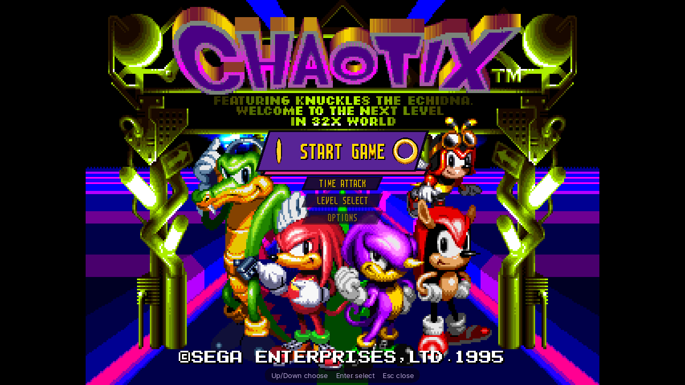

# The menu's font and backdrops (issue #8)

Issue #8 asked for the menu to look like the game: its own font instead of
the bundled pixel face, and pictures of its zones behind the menu instead of
plain colour. Both are made from the player's ROM when the program runs;
nothing of the game is in the repository or in a release.

| Setting | Values | Default | `[Video]` key |
| --- | --- | --- | --- |
| OPTIONS > EXTRAS > MENU FONT | GAME, PIXEL | GAME | `MenuFont = Game` |
| OPTIONS > EXTRAS > MENU BACKGROUND | CYCLE, WORLD ENTRANCE, ISOLATED ISLAND, BOTANIC BASE, MARINA MADNESS, SPEED SLIDER, AMAZING ARENA, TECHNO TOWER, PLAIN | CYCLE | `MenuBackground = Cycle` |

The `MenuBackground` values are `Cycle`, `Plain` and the zones' names
without spaces (`WorldEntrance`, `IsolatedIsland`, `BotanicBase`,
`MarinaMadness`, `SpeedSlider`, `AmazingArena`, `TechnoTower`), case ignored.
`Zone`, the value from before the zones could be chosen (issue #37), reads
as `Cycle`, and so does anything unknown.

PIXEL and PLAIN are the look from before. The new look is the default
because it is what was asked for, both parts come from the ROM the player
already has, and both fall back on their own: a ROM without the font at its
address keeps the pixel face, and until a zone's picture exists the menu is
plain. The two rows are under EXTRAS because VIDEO already has as many rows as
a phone's screen holds.

## The font

The TRAINING and DATA LOAD screens write zone names ("ISOLATED ISLAND") with
an 8x16 font of Mega Drive sprites: white digits shaded in lilac, yellow
capitals shaded in brown, a black drop shadow on every glyph. It was
found by dumping VRAM on the TRAINING screen, reading the VDP's sprite table
(each letter is a 1x2-tile sprite: `I` is tile 0x524, `S` 0x538, ...), and
logging the 68K writes into those tiles: the decompressor at $8F49C6 writes
them straight to the VDP data port from $9C4B20 (ROM bank 2).

- **Tiles:** ROM 0x2C4B20, Nemesis-compressed (the usual Sega format), header
  0x805E: XOR mode, 94 tiles. Decoded, they are exactly what the game puts in
  VRAM at 0xA000.
- **Glyphs:** 47 of them, two tiles each (top, then bottom), in this order:
  `0`-`9`, `A`-`Z`, `?` `!` `-` `,` `.` `♂` `♀` `_` `“` `”` `’`. There is no
  lower case and no space glyph (the game leaves a gap). Every glyph is 8
  pixels wide, ink in columns 1-7 (the shadow included) and lines 1-15.
- **Colours:** palette line 0 of those screens, 16 words at ROM 0x03E8CA.
  The digits use entries 1-3 (white, lilac, dark purple), the letters 10-12
  (yellow, brown, dark red), the shadow entry 5 (black).

`renderer/game_font.*` decodes it (`nemesis_decode`, `build_game_font`) and
builds an atlas of 50 glyphs, 400x16: the ROM's 47, plus `:` (the full
stop's dot twice) and `<` `>` (triangles in the letters' yellow with the
shadow), which the menu's values and arrows need. Lower case is drawn as
upper case, `"` and `'` as the curly ones. The header and the palette words
are checked, so a different ROM is refused rather than misread.

`ui::Ui` draws the pixel fonts (the menu's labels, values and headings) with
it when MENU FONT is GAME and the font has every character of the string; a
string with anything else (`%`, `/`) keeps the pixel face, whole, centred in
the same line. Glyph pixels become whole screen pixels: the scale is the
pixel face's size over 16, rounded (1 at 720p for labels and 2 for headings,
2 and 3 at 1080p), positions are rounded, and the texture is sampled
nearest-neighbour. The text's colour only sets the glyphs' brightness (full
for the selected entry and headings, about two thirds for the others), so
the game's own colours are kept. Captions and hints keep the small text
face; the touch controls and notifications keep the pixel face.

`chaotix_headless --game-font FILE.png` writes the atlas.

**MENU SIZE (issue #49).** OPTIONS > VIDEO > MENU SIZE lays the menu out
larger: `ui::Ui::set_zoom` multiplies the layout scale by 1, 1.5 or 2 for
NORMAL, LARGE and EXTRA LARGE (the app sets it before each frame while the
menu is open, NORMAL otherwise, so the speedrun overlay, the rewind label and
the touch controls are untouched). The pixel faces cannot follow a factor:
they snap to their 8-pixel grid and the game's font to whole scales, so the
1.5 of LARGE and the 2 of EXTRA LARGE could round to the same letters. So
`ui::pixel_steps` keeps NORMAL exactly as it was and, for each size above,
takes the game's font to the whole scale the factor reaches (rounded down:
rounding up made LARGE's headings 80 pixels tall on a 1080-line phone, 48 at
NORMAL), but at least one scale more than the size below, with the pixel face
about as tall. On a 1080-line phone the rows' letters are 32, 48 and 64
pixels tall; in a 720-line window 16, 32 and 48. Glyphs stay on whole pixels
at every size. The rows are also spaced a little more at each size (4 units
a step), so the touch targets grow faster than the letters.

AUTO, the default, is LARGE on Android and iOS and NORMAL elsewhere. A phone
in landscape is about 1080 pixels and 6-7 cm tall: at NORMAL a settings row is
56 pixels, about 21 dp and under 4 mm, well below the 48 dp a touch target
should be and the "too small, too much empty space" of the report; LARGE's is
about 93 pixels (35 dp), EXTRA LARGE's 136 (52 dp).

Pages with more rows than fit (the settings lists at a larger size on a short
screen) show a window of them that follows the selection, with a marker that
steps it. The front end shows as many of its entries around the selected one
as fit (see below). The pause menu's row carries on onto a second line rather than off the screen.
Anything still too wide for its column is shortened with an ellipsis.
`tests/test_menu_size.py` runs the program at each size in an 800x360, a
412x860 and a 1280x720 window and checks every touch target is on the screen
and taller than at the size below; `menu_size.*` in `tests/test_menu.cpp`
does the same for every page kind on an off-screen renderer, 2400x1080
included.

## The backdrops

A backdrop is a picture of a zone at a time of day, made by the game itself:
`render_backdrop` (`frontend/backdrop.*`) builds a second `Machine` from a
copy of the ROM, starts the stage the way TIME ATTACK does (the request at
the mode dispatcher, Start tapped until it is taken), runs 480 frames more so
the title card has gone, and keeps the frame buffer. The playing machine is
never involved.

- **Wide:** rendered with 40 extra columns a side (400x224, about 16:9), as
  WIDESCREEN renders levels. The lobby is 4:3, as the game keeps it.
- **No characters or HUD:** the backdrop machine's sprite recorder gets a pack
  that replaces every frame of banks 0-15 (the characters), 0x13 (the
  HUD) and 29 (the seven dots of the tether between the two characters,
  scaled; found with `--sprites-log`, the same bank in every zone) with an
  empty image, so they are left out of the picture
  (`runtime/sprite_replace.h`; output only, like every replacement).
  `BackdropImage::hidden_draws` counts the draws left out of the kept frame,
  and `--backdrop` prints it.
- **Interpreted:** the recompiled code keeps one machine's state in globals
  (`game/recomp_dispatch.cpp`), and that machine is the one being played, so
  the backdrop machine runs on the reference interpreters, which keep all
  their state in the machine. That is what lets it run on another thread.

The zones, in the order they are made and shown: Marina Madness 2 at sunset
(the picture the issue showed), Botanic Base 3 in the morning, Speed Slider 1
at night, Techno Tower 1 at sunset, Amazing Arena 2 by day, World Entrance at
sunset, and Isolated Island by day. Botanic Base 1 is not used: it starts by
the level's left edge, which shows tiles from beyond it.

World Entrance and Isolated Island are the game's own places, reached
through the stage select like the attractions (`runtime/stage_select.h`):

- **World Entrance** is place 7 (WORLD ENTRANCE), level 0: the lobby's hall,
  with the EXIT and PLAY signs, 4:3 as the game keeps
  it. (Before issue #37 this picture was the one called Isolated Island.)
  Its other levels are no picture: level 1 is the same hall with the
  attractions open, and from level 2 on they are the bonus-stage and
  special-stage entrances, black or white with a few sprites.
- **Isolated Island** is place 6 (INTRODUCTION), level 0: the outdoor level
  the game opens with, palms and grass, rendered wide (its start is clean
  in the margins). The game's own times of day apply to it.

**Cost.** About 620 emulated frames each, interpreted: 1.8-2.3 s per picture
on the development PC (Windows, about 330 frames a second interpreted), 13-16
s for all seven. A phone is maybe 3-10 times slower, so tens of seconds per
picture there. It happens once per ROM, on a low-priority thread
(`platform/backdrops.*`), one picture at a time, and the menu does not wait:
it is plain until the first picture is ready and picks the others up as they
arrive. With MENU BACKGROUND on PLAIN nothing is made at all.

With one zone chosen, only that zone's picture is made (`MenuBackdrops::
choose`), and it goes first: a picture CYCLE had under way is given up
(cancelled, not marked failed) so the chosen one starts at once, and the
menu is plain until it is ready. The others are made only if CYCLE is
chosen again. Pictures already in the cache are loaded whatever the choice,
so stepping through the zones in the menu shows each one at once that has
been made before.

The worker never competes with the game: slow machines have no core to spare
(issue #31's Celeron needed 20-37 ms a frame; phones share caches and thermal
headroom between few cores). It starts only while the front end or a menu
page is open, and the moment the game is played with no menu open it is held
between two frames of its machine (`BackdropControl::pause`, polled before
each one; a frame takes about 3 ms on the development PC) -- paused, not
cancelled -- and it carries on from there when a menu opens again. So on a
slow machine the pictures appear over a few visits to the menu. Autotests
still wait for the first picture before they run.

**Cache.** Each picture is written as a PNG to
`<user data>/Cache/Backdrops/v2-<first 12 hex digits of the ROM's SHA-1>/<zone>.png`
(the patched image's SHA-1 when ROM patches are applied, since they can change
the levels' art), and later starts load them at once. Delete the folder to
make them again. They are derived from your ROM and stay on your device.
`v2` since the tether is left out too (issue #37); `v1` pictures are not used.

**On screen.** On CYCLE, each time the menu opens it shows the next zone; a
chosen zone stays, and a new choice shows at once (or plain until its picture
is made). The tint and accent below come from whichever picture is shown. The
picture
covers the area (cropped to its shape, never stretched) and a translucent
coat of the zone's own colour goes over it (`backdrop_tint`: the picture's
average colour at a third of its brightness) so that the white and yellow
letters stay readable: over the whole window behind the awards and the zone
showcase, inside the band of the pause row. Since issue #3 the front end has
no zone behind it (it is drawn on the game's title screen, below), and nor do
the settings pages' panels, which are plain over the dimmed title.
The frames, markers and arrows take the zone's most common vivid colour
(`backdrop_accent`) instead of the awards' magenta (the theme's blue before issue #3). In a level the game stays
visible around the panel, dimmed as before.

`chaotix_headless --backdrop all|KEY|PLACE:LEVEL:TIME[:WIDE] DIR` renders
backdrops to `DIR` and says how long each took.

**Lockstep.** Nothing here writes to the playing machine. The ROM test
`game_font.a_backdrop_renders_beside_a_playing_machine` plays 700 frames on
the recompiled machine while a backdrop is made on another thread, and the
frames must hash the same as a run without it; `lockstep_*` and the golden
frame tests are unchanged.

## TIME ATTACK and LEVEL SELECT: the zone showcase (issue #53)

Both pages share one layout (`Menu::draw_showcase`). The entries are the
same as before, in the order up and down step through them: PLACE, LEVEL,
AT-TIME, PLAYER, COMBI, (BEST TIME, read only, and GHOST on TIME ATTACK),
PLAYERS, START, BACK. Left and right change the selected one, Enter steps a
value or starts. What changed is where they are drawn:

- **The stage's picture** on the left, about three fifths of the width, with
  the place's name over its foot in the game's letters between arrows. Under
  it a row of chips for the levels the place offers (ACT, or STAGE 1-6 for a
  special stage) and one for the time of day. The value chosen is the yellow
  chip.
- **On the right:** the PLAYER and PARTNER cards, each with the character
  standing and its name between arrows; the RECORDS card (the best time for
  the stage chosen and the GHOST chips) on TIME ATTACK, or LEVEL SELECT's
  "practice" note; the PLAYERS chips; a large START. BACK is at the top right.
- **Touch** acts on one tap: a chip chooses, an arrow steps, START starts.
  Tapping a card or a row elsewhere selects it, and a second tap steps it.
- **Screen sizes:** everything is measured in the menu's letters, so MENU
  SIZE (issue #49) grows all of it. The picture is drawn at a whole multiple
  of its pixels when that is within 15% of the room it has. A portrait
  window, or a short one at a larger MENU SIZE where the picture's column
  would not fit, stacks the pieces in one column (the two cards side by side,
  standing up, when they fit). A column taller than the window scrolls to
  keep the selected entry in view, with markers where there is more.

**Stage pictures** are backdrops made on demand (`MenuBackdrops::stage`,
`stage_backdrop_spec`): any place, level and time of day the stage select
starts, the bonus stage and special stages included. They are 4:3 (320x224,
not wide), and the player walks right for 160 frames once it has control
(from 380 frames after the stage is taken; 640 frames are run in all), so
that the picture shows the level rather than its starting edge (BOTANIC BASE
1 starts against its left edge). They are made by the same worker, one at a
time, ahead of the menu's own pictures and whatever MENU BACKGROUND is set
to; a picture being made for a selection the player has moved on from is
given up. While one is made the page shows another picture of the same place
if there is one, darkened, with LOADING over it. About 900 emulated frames:
2.5-3 s on the development PC. They are cached beside the others as
`stage_pPP_lL_tT.png` and at most 24 are kept as textures. The bonus stage
comes out black (its picture is not in the frame buffer), which counts as no
picture: the page then shows the menu's zone, darkened, instead.

**Character sprites** (`frontend/portrait.h`) are the first standing frame
(frame 0) of the character's body bank in the ROM's 32X bank table, read as
EXPORT SPRITES reads it (`read_rom_bank`), in the colours shown for the
player. A sprite mod for that bank and frame (`32x_<BB>_00.png`, or a
sheet's cell) replaces it, and a character mod's `[Palette]` recolours it,
as both do in play; they are made again when the mods are reloaded. All
characters are drawn at one whole-number scale, taken from the tallest
(Vector), so that switching keeps them in proportion. Slot 1 has no graphics
and shows a question mark.

## The front end on the title screen (issue #3)

Issue #3 asked for the front end to feel like the game's own title screen
rather than an emulator's list beside a picture of it, in the way Sonic 3
A.I.R. builds its menus into the game. Since then:

- **The title fills the window**, exactly as the game does in play: the
  ASPECT RATIO, SCALING and WIDESCREEN settings place it (the title screen is
  4:3 in every mode; the attract demo goes wide when WIDESCREEN is on). The
  app tells the menu where the picture is each frame (`Menu::set_picture`).
  Nothing is laid over it but the entries and a small hint at the foot.
- **The selected entry covers PUSH START.** The title screen shows PUSH START
  in a lime-green frame under the logo, columns 114-206 and lines 75-101 of
  its 320x224 picture once it has settled (measured on the program's own
  screenshots). The title zooms in for its first moments (it is shown from
  about frame 1400 after power-on and settles about frame 1520; the attract
  demo follows about frame 1950), so a picture taken before then shows the
  logo cut off at the top and the frame lower and larger. The selected entry
  is drawn on a purple plaque over the inside of the settled frame
  (`Menu::push_start_box`: columns 115-205, lines 76-100), at least that large
  at every window size and MENU SIZE, so the game's prompt and ours are never
  both on the screen. This is drawing only: the game still shows PUSH START
  underneath and runs exactly as it would without the menu, so lockstep and
  the golden frames are untouched.
- **The other entries are under it**, in the order Down reaches them (round
  past the last to the first), on smaller night-purple banners. Nothing is
  drawn above the box: the logo and the line under it ("FEATURING KNUCKLES
  THE ECHIDNA ... IN 32X WORLD") stay clear, and a plaque taller than the box
  grows downwards only. In a landscape window three of them follow it over the
  characters, fading. Up and down move the selection, so the chosen entry is
  always where the player looks for PUSH START.
- **A portrait window** has the room under the picture: while the menu is
  over the title the picture goes to the top of the window
  (`Menu::title_picture_y`; the game goes back to the usual centring once it
  is handed over), and the whole menu is a column under it, over black, in
  its own order (START GAME to QUIT, no wrapping), with the selected entry's
  place marked: purple edged in magenta, in full brightness. A phone holds all
  of it at NORMAL and LARGE; a column too long for the room shows a window of
  it that keeps the entries either side of the selection in view. The plaque
  stays on PUSH START, in the smaller letters if the large ones would make it
  much taller than the box.
- **The cursor** is a pair of spinning gold rings at the plaque's ends, a
  quarter turn apart: the two rings of the game's combi. Plaque, stripe and
  banners are `award_art`'s shapes (`banner`, `ring`, `heading`,
  `arrowhead`), the same as the AWARDS page's; no picture is taken from the
  game.
- **The intro and the attract demo** still run behind the front end; the
  plaque stays where PUSH START will be.

**Touch.** A tap on an entry brings it into the box; a tap on the plaque (or
on the selected entry's place in the portrait column) acts on it (the first
tap selects, the second acts, as on every list). While the entry before the
selected one is not shown, a magenta arrow beside the plaque -- or at its
right-hand end in place of the ring when there is no room beside it -- steps
back; while the one after it is not shown (an 800x360 window at EXTRA LARGE),
a second one steps on.

**Sizes.** Everything is measured in the menu's letters, so MENU SIZE grows
the plaque, the banners and their spacing.

**MENU FONT and MENU BACKGROUND.** MENU FONT works as everywhere: GAME draws
the entries in the game's letters, PIXEL in the pixel face, on the same
plaque. MENU BACKGROUND no longer applies to the front end, whose background
is the live title screen, nor to the settings pages' panels. It still sets
what is behind the awards, the zone showcase and the pause menu's band.

**The pages behind it.** OPTIONS and its categories, CONTROLS, the binding
pages, MODS, MUSIC PLAYER and NETPLAY keep their lists, now with the page's
name on the AWARDS title's slanted banner at the panel's top, a spinning ring
for the cursor, and the panel in the awards' near-black purple edged in
magenta (no zone's picture inside it: that made two pictures one over the
other), over the title dimmed in the same purple. The panel is as wide as the
page needs -- its longest row with its value and note, its heading and its
hint, in steps of 40 units so that stepping a value does not make it twitch
-- up to the width it always had; a pack's page keeps the whole width for its
description. TIME ATTACK and LEVEL SELECT put their names on the same banner.
The frames, values and arrows that were the theme's blue are the awards'
magenta (on the showcase and the awards, the zone's colour while its picture
is shown). The pause menu over a level is unchanged.

`tests/test_menu.cpp` (`front_end.*`) checks that the selected entry covers
the box for every entry, at every MENU SIZE, in 16:9, 4:3, phone, portrait and
short windows and with both fonts; that nothing rises above the box; that the
other entries are under the plaque; that on a portrait window the column is
under the picture, in the menu's own order, with the selection's neighbours
in view (all of it on a phone up to LARGE); and that taps select and start.
`menu.the_settings_panel_is_plain_and_fits_its_rows` checks the panel shows
no zone and is narrower than before; `menu_size.*` and
`tests/test_menu_size.py` check the touch targets grow and stay on the screen.

